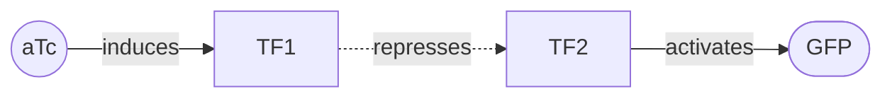
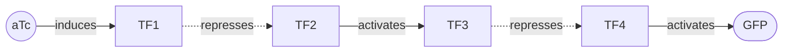
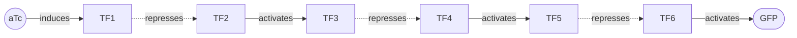

# Quiver 🏹

**A machine learning library for the diverse design of gene-regulatory circuits.** Designing a genetic
circuit is usually a single careful shot: choose a topology, tune it, build it, and hope it holds its
behavior in a living cell. Quiver approaches it as _discovery_ rather than a one-shot bet. You give it a
target cellular behavior (a sensor with a specified dose-response, a switch, an oscillator) and it hands
back a _quiver_ of diverse candidate circuits that realize it: structurally distinct designs, each a
[LOICA](https://github.com/RudgeLab/LOICA) circuit graph scored by simulating its dynamics, to carry to the
bench as a batch rather than as a single prediction.

Why a quiver and not one arrow: a simulation is only a proxy for how a circuit behaves in a cell, so the
single best-scoring design is a fragile thing to stake a build on. A set of high-scoring, _structurally
distinct_ candidates is many independent shots, and because they fail for different reasons the set is far
likelier to contain one that lands the spec, and it tells you which structural choice worked. Quiver
therefore takes the choice of circuit _topology_ as the design problem and optimizes for the diversity of
the set, not its peak score. (Fittingly, a quiver is also a directed graph, which is what a gene-regulatory
circuit is.)

Quiver gives you the design loop as composable pieces: a typed, mutable circuit design object, a
simulation-based behavior objective, a family of generators from classical search to a diversity-seeking
learned sampler, and an evaluation instrument that measures the diversity and quality of the portfolio a
generator surfaces.

## The domain: designing gene-regulatory circuits

A **gene-regulatory circuit** is an engineered network of genes that regulate one another's expression:
promoters, transcription factors, and reporters wired so that the whole produces a target behavior.
Synthetic biologists build them from libraries of _characterized parts_ whose input/output behavior has
been measured, and compose those parts into recurring **device classes**:

- **Sensor:** reporter output tracks an input's concentration, a dose-response set by a half-maximal input
  (EC50), a dynamic range (fold change), and a direction (induction or repression).
- **Switch / toggle:** a sharp, near-digital response, or a bistable memory that latches one of two states.
- **Oscillator:** an autonomous limit cycle, as in the repressilator.
- **Logic gate / homeostat:** a Boolean function of inputs, or a setpoint held invariant to disturbance.

Designing one is hard for reasons that motivate a _portfolio_: the map from wiring and kinetic parameters
to behavior is nonlinear (Hill kinetics, feedback); many structurally different topologies can realize the
same target; and a prediction is only a prediction until the circuit is built and measured. Genetic design
automation tools ([Cello](https://doi.org/10.1126/science.aac7341), iBioSim, and
[LOICA](https://github.com/RudgeLab/LOICA)) automate parts of this pipeline; Quiver takes the _choice
of circuit topology_ itself as the object of search.

## From a target to LOICA circuits

Quiver turns a target behavior into a batch of distinct **LOICA circuits** that realize it. You state the
target as a transfer function and `quiver.design` hands back a ranked portfolio of structurally distinct
circuits, each a LOICA `GeneticNetwork` you can draw, simulate, or carry into the rest of your workflow.

```python
import quiver
from quiver.objective import TargetResponse, dose_response_match, simulate

# State the target: a GFP sensor that switches around aTc = 1 with a ~100x dynamic range.
target = TargetResponse(signal="GFP", ec50=1.0, dynamic_range=100.0, direction="any")
behavior = dose_response_match(target)

# One call trains a diversity-seeking GFlowNet for this behavior and samples a broad, de-duplicated
# portfolio of distinct high-scoring circuits, ranked best-first.
portfolio = quiver.design(behavior)

# The top-scoring circuit as a LOICA `GeneticNetwork` object, which you can draw or simulate.
network = portfolio.networks()[0]

# Draw the wiring diagram of the top-scoring circuit.
network.draw()

# Simulate the top-scoring circuit to see how it behaves in silico.
result = simulate(portfolio.best[0])         # or run its dose-response assay through LOICA
```

The GFlowNet is the point: rather than hill-climbing to one optimum, it learns to _sample_ circuits in
proportion to their score, so a single run surfaces a diverse portfolio instead of one design. `portfolio.circuits`
and `portfolio.scores` give the ranked circuits and their scores, a `Portfolio` iterates as `(circuit, score)`
pairs, and `method="evolutionary"` swaps in a non-learned baseline for a quick comparison.

Designing for many targets? Training a fresh policy on every call is wasteful. A `quiver.Designer`
conditions the policy on the target, so you train **once** across a distribution of targets and then design
any target cheaply, with no retraining, including targets held out of training:

```python
import quiver
from quiver.objective import sensor_target_grid

# train once across a target distribution
designer = quiver.Designer.train(sensor_target_grid())

# you can save the weights and config to disk for later use
designer.save_pretrained("gfp-sensor-designer")
designer = quiver.Designer.from_pretrained("gfp-sensor-designer")

# or publish to Hugging Face Hub for others to download and use
designer.push_to_hub("your-username/quiver-gfp-sensor")
designer = quiver.Designer.from_pretrained("your-username/quiver-gfp-sensor")

# design any target cheaply, with no retraining
switch = designer.design(TargetResponse("GFP", ec50=1.0, dynamic_range=100.0, direction="any"))
sharp  = designer.design(TargetResponse("GFP", ec50=0.1, dynamic_range=50.0, direction="up"))
```

Each design is a different set of parts to assemble, but each realizes the one spec. For this target the
portfolio is a family of **inducible transcriptional cascades** of increasing depth: `aTc` is sensed by a
LOICA `Receiver` that expresses the first transcription factor, which drives a chain of `Hill1`-regulated
promoters (alternating repression and activation) terminating at the `GFP` `Reporter`. Depth is the
structural axis — each extra relay stage shifts the effective switch point — so a shallow cascade and a deep
one hit the same EC50 by different routes. Three distinct members that clear the threshold, drawn as their
LOICA wiring (`--` activation, `-.-` repression):

A minimal two-stage relay (score ≈ 0.87):



A four-stage cascade that shifts the switch point (score ≈ 0.91):



A six-stage cascade (score ≈ 0.59):



Building only the textbook circuit would pin you to _its_ threshold and dynamic range rather than the ones
you asked for.

## The three parts

1. **The design object** (`quiver.grn`): a gene-regulatory network as a bipartite graph of genetic
   species (regulators, reporters, supplements) and regulatory operators (constitutive, Hill-activated,
   Hill-repressed, two-input logic, additive), wired into a topology and parameterized by Hill kinetics.
   This is what a search proposes and mutates, and it maps to buildable parts.
2. **The objective** (`quiver.objective`): a candidate is scored by _simulating_ its dynamics
   ([LOICA](https://github.com/RudgeLab/LOICA) compiles the network to ODEs and runs a dose-response
   assay), detecting the target behavior, and measuring its **robustness over a parameter ensemble**. The
   target is stated in the same transfer-function language a synthetic biologist uses, so the objective is
   a dense, quantitative signal _and_ one a bench scientist can read.
3. **The generators** (`quiver.generate`): strategies that propose circuits, from classical search and
   mutation to amortized, diversity-seeking learned samplers (a constructive GFlowNet) where simulating
   every topology under a fixed budget is infeasible and the space becomes non-enumerable as circuits grow.
   Scored by the objective and compared on portfolio diversity (`quiver.eval`).

## Where this fits in a synthetic biology workflow

Quiver occupies the _design_ step of the **Design-Build-Test-Learn (DBTL)** cycle, in the language the
rest of the cycle speaks:

- **Design.** Specify a target as a transfer function; Quiver returns a _portfolio_ of distinct
  topologies that meet it in simulation, robustness-scored across a parameter ensemble rather than tuned to
  a single lucky parameterization.
- **Build.** A chosen topology is a concrete part list and set of regulatory links.
- **Test.** Assemble the strains and run the dose-response on a plate reader.
- **Learn.** The `quiver.objective.reference` module scores a candidate against a _reference
  dose-response curve_ using the same shape metric whether that curve is simulated or measured, reading
  measurements through the Flapjack characterization data model (requires the `data` extra).
