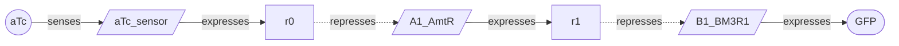

# Quiver 🏹

**Machine learning for the diverse design of gene-regulatory circuits.** Give Quiver a target cellular
behavior (a sensor with a set dose-response, a switch, an oscillator) and it returns a _quiver_ of candidate
circuits that realize it: structurally distinct [LOICA](https://github.com/RudgeLab/LOICA) designs, scored in
simulation and, given a parts library, built from characterized components, to carry to the bench as a batch
rather than as a single prediction.

Designing a circuit is usually one careful shot. Quiver treats it as _discovery_ instead: a simulation is only
a proxy for behavior in a cell, so a set of high-scoring, structurally distinct candidates that fail for
different reasons is far likelier to contain one that lands the spec than the single best-scoring design.
Quiver therefore optimizes the quality and diversity of the portfolio, not its peak score. (A quiver is also a
directed graph, which is what a gene-regulatory circuit is.)

## Design a portfolio

State the target as a transfer function and `quiver.design` returns a ranked portfolio of distinct circuits,
each a LOICA `GeneticNetwork` you can draw, simulate, or export.

```python
import quiver
from quiver import load_cello
from quiver.objective import TargetResponse, dose_response_match

# A GFP sensor that switches around aTc = 1 with a ~100x dynamic range.
target = TargetResponse("GFP", ec50=1.0, dynamic_range=100.0, direction="any")
behavior = dose_response_match(target)

# Train a diversity-seeking GFlowNet and sample a de-duplicated portfolio,
# every stage grounded in a real characterized part.
portfolio = quiver.design(behavior, library=load_cello())

network = portfolio.networks()[0]   # top circuit as a LOICA GeneticNetwork
network.draw()
```

`portfolio.circuits` and `portfolio.scores` give the ranked designs and their scores, and iterating a
`Portfolio` yields `(circuit, score)` pairs. Omit `library` to sample abstract circuits whose kinetics are
tuned rather than grounded.

## Built from real parts

With a `library`, the graph policy chooses a concrete **SBOL Component** for every stage as it builds the
circuit: the input sensor from the target inducer, and each promoter from a repressor gate, masked so no
transcription factor is reused. A delivered design is a genuine bill of parts whose kinetics are measured
values, and it carries part identity through to LOICA and SBOL.

```python
grounded = portfolio.circuits[0]
[node.component_id for node in grounded.nodes if node.component_id]  # the parts this design is built from
```

`load_cello()` supplies 63 repressor gates and 21 input sensors with characterized Hill kinetics. That corpus
is repressor-only, so the cascades are repressor chains; richer components (activators, sensor cooperativity)
plug into the same `ComponentLibrary`. Depth is the structural axis, so a portfolio spans shallow and deep
cascades that reach the same target by different routes:



## How it scores and samples

The score is `buildable_objective`, not a bare shape match. It multiplies _robustness_, the mean
behavior-detector score over an ensemble of perturbed parameterizations, by a _burden discount_,
`1 - J/(1+J)` for total expression demand `J`, so a design is rewarded for holding under perturbation without
starving the host. Pass `robust=False` for a single-simulation shape match, or `burden_capacity=None` to score
robustness alone.

The generator is a constructive GFlowNet: it learns to _sample_ circuits in proportion to their score rather
than hill-climb to one optimum, which is what surfaces a diverse portfolio. The default graph policy reads the
circuit as a graph, message passing over physical node features (operator sign, Hill `K` and `n`, dynamic
range); `policy="mlp"` swaps in a feature-summary policy. These are methodological choices within one
strategy, not competing approaches.

## Amortize across targets

A `quiver.Designer` conditions the policy on the target, so you train once across a distribution of targets
and then design any target cheaply, including targets held out of training, with no retraining.

```python
from quiver.objective import sensor_target_grid

designer = quiver.Designer.train(sensor_target_grid())
designer.save_pretrained("gfp-sensor-designer")   # or push to the Hugging Face Hub
portfolio = designer.design(target)
```

## Deliver into build-and-test

Every design is a LOICA `GeneticNetwork`: draw it, simulate it (ODE or stochastic), export it to SBOL, and
persist it through the [Flapjack](https://github.com/RudgeLab/LOICA) pipeline that scores a measured build.
The same shape metric scores a candidate against a _measured_ dose-response as against a simulated target, so a
real curve can replace the objective without touching the sampler. Quiver is the _design_ step of the
Design-Build-Test-Learn cycle, in the language the rest of it speaks.

## Layout

`quiver` is the shipped toolkit: the design object (`quiver.grn`), the parts library (`quiver.component`), the
simulation objective (`quiver.objective`), and the learned sampler (`quiver.learn`). The non-learned baselines,
the evaluation harness, and the experiments that validate the method live under `quiver.research`.

## Install

Quiver is not on PyPI yet, so install it from its Git remote. There are no optional extras: one install pulls
every dependency, including LOICA, torch, and the learned samplers.

```bash
pip install "quiver @ git+https://github.com/marpaia/quiver.git"
```

For development, clone the repository and install it in editable mode:

```bash
git clone git@github.com:marpaia/quiver.git
cd quiver
pip install -e .
```
