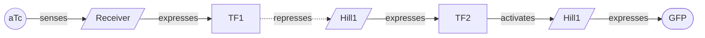

# Quiver 🏹

**A machine learning library for the diverse design of gene-regulatory circuits.** You give Quiver a target
cellular behavior (a sensor with a specified dose-response, a switch, an oscillator) and it hands back a
_quiver_ of candidate circuits that realize it: structurally distinct designs, each a
[LOICA](https://github.com/RudgeLab/LOICA) circuit graph scored by simulating its dynamics, to carry to the
bench as a batch rather than as a single prediction.

Designing a genetic circuit is usually a single careful shot: pick a topology, tune it, build it, and hope it
holds its behavior in a living cell. Quiver treats it as _discovery_ instead. A simulation is only a proxy
for how a circuit behaves in a cell, so the single best-scoring design is a fragile thing to build on. A set
of high-scoring, structurally distinct candidates is many independent shots, and because they fail for
different reasons the set is far more likely to contain one that lands the spec. Quiver therefore takes the
choice of circuit _topology_ as the design problem and optimizes the quality and diversity of the portfolio,
not its peak score. (A quiver is also a directed graph, which is what a gene-regulatory circuit is.)

Two choices keep the portfolio _buildable_ rather than merely high-scoring on paper. The objective is
buildability-aware: a candidate is scored by how robustly its target behavior holds over a parameter
ensemble, discounted by the metabolic burden its topology puts on the host, so a design that works only at
one lucky parameterization, or that demands more expression than a cell can spare, scores low. And the policy
reads circuit physics: the learned generator is a graph neural network over the circuit graph whose nodes
carry the operator sign and Hill kinetics, so it conditions on the kinetics and wiring a fixed feature
summary would hide. One policy amortizes across a distribution of targets, so you train once and design any
target cheaply, and every design round-trips to LOICA and to a circuit-design tool, so a portfolio arrives
editable, simulable, and ready for build and test.

## From a target to a portfolio of circuits

State the target as a transfer function and `quiver.design` returns a ranked portfolio of structurally
distinct circuits, each a LOICA `GeneticNetwork` you can draw, simulate, or carry into the rest of your
workflow.

```python
import quiver
from quiver.objective import TargetResponse, dose_response_match, simulate

# State the target: a GFP sensor that switches around aTc = 1 with a ~100x dynamic range.
target = TargetResponse(signal="GFP", ec50=1.0, dynamic_range=100.0, direction="any")
behavior = dose_response_match(target)

# One call trains a diversity-seeking GFlowNet for this behavior and samples a broad,
# de-duplicated portfolio of distinct buildable circuits, ranked best first.
portfolio = quiver.design(behavior)

# The top-scoring circuit as a LOICA GeneticNetwork, which you can draw or simulate.
network = portfolio.networks()[0]
network.draw()

# Simulate the top-scoring circuit to see how it behaves in silico.
result = simulate(portfolio.best[0])
```

`portfolio.circuits` and `portfolio.scores` give the ranked circuits and their scores, and iterating a
`Portfolio` yields `(circuit, score)` pairs. The GFlowNet is the point: instead of hill-climbing to one
optimum, it learns to _sample_ circuits in proportion to their score, so a single run surfaces a diverse
portfolio rather than one design. There is one design strategy; `policy="mlp"` swaps the graph policy for the
feature-summary policy (a methodological choice, not a different approach).

## The buildability-aware objective

By default `quiver.design` optimizes `buildable_objective`, not a bare dose-response shape match. A
candidate's score multiplies two terms. The first is _robustness_: the mean behavior-detector score over an
ensemble of log-normally perturbed parameterizations, so a design that meets the target only at its nominal
point scores far below one that holds under perturbation. The second is a _burden discount_: an analytic
penalty `1 - J/(1+J)` where total demand `J` sums each operator's expression against a shared cellular
budget, so deeper, higher-expression cascades that would starve the host score lower with no extra
simulation. Pass `robust=False` for the cheaper single-simulation shape match, or `burden_capacity=None` to
score robustness alone.

Parameter tuning is clamped to kinetics real parts achieve. The Hill coefficient stays in `[1, 5]` and the
achievable dynamic range stays under about `3e3`, ranges taken from a corpus of characterized Cello response
functions (`data/cello`). This stops the search from hitting a target with a cooperativity or fold change no
promoter reaches.

## A policy that reads circuit physics

The generator builds a circuit one move at a time and learns which move to make. The default graph policy
(`policy="gnn"`) reads the circuit as a graph: directed message passing over the bipartite wiring builds node
embeddings from physical features (kind, activation or repression sign, Hill `K` and `n`, dynamic range,
degradation), and a per-regulator head chooses which regulator to relay from or rewire to. The feature-summary
policy (`policy="mlp"`) instead reads a small fixed summary of the partial circuit.

```python
portfolio = quiver.design(behavior)              # the graph policy is the default
portfolio = quiver.design(behavior, policy="mlp")  # or the feature-summary policy
```

Reading the circuit as a graph is a relational inductive bias: the policy conditions on the kinetics and
signed wiring that set behavior, and the representation carries across circuit sizes instead of compressing
every circuit to a fixed vector.

## Design from real SBOL Components

Pass a `library` and the graph policy chooses a concrete characterized **SBOL Component** for every stage as it
builds the circuit, rather than emitting abstract Hill kinetics: the input sensor from the target inducer, and
each promoter stage from a repressor gate, masked so no transcription factor is reused (orthogonality). The
delivered circuit is a real bill-of-Components whose kinetics are the measured part values, so it carries part
identity through to LOICA and SBOL.

```python
from quiver import load_cello

library = load_cello()  # 63 repressor gates + 21 input sensors, characterized Hill kinetics
portfolio = quiver.design(behavior, library=library)

grounded = portfolio.circuits[0]
[node.component_id for node in grounded.nodes if node.component_id]  # the parts this design is built from
```

The Cello corpus is repressor-only and its sensors carry no measured cooperativity; richer Components
(activators, sensor `K`/`n`) come from other sources plugged into the same `ComponentLibrary`.

## Amortize across many targets

Training a fresh policy on every call is wasteful when you design for many targets. A `quiver.Designer`
conditions the policy on the target, so you train once across a distribution of targets and then design any
target cheaply, with no retraining, including targets held out of training.

```python
import quiver
from quiver.objective import TargetResponse, sensor_target_grid

# Train once across a target distribution.
designer = quiver.Designer.train(sensor_target_grid())

# Save the weights and config to disk, or publish to the Hugging Face Hub.
designer.save_pretrained("gfp-sensor-designer")
designer = quiver.Designer.from_pretrained("gfp-sensor-designer")

# Design any target cheaply, with no retraining.
switch = designer.design(TargetResponse("GFP", ec50=1.0, dynamic_range=100.0, direction="any"))
sharp  = designer.design(TargetResponse("GFP", ec50=0.1, dynamic_range=50.0, direction="up"))
```

For a sensor target the portfolio is a family of inducible transcriptional cascades of increasing depth:
`aTc` is sensed by a LOICA `Receiver` that expresses the first transcription factor, which drives a chain of
`Hill1`-regulated promoters (alternating repression and activation) ending at the `GFP` `Reporter`. Depth is
the structural axis, so a shallow cascade and a deep one reach the same target by different routes. Two
distinct members that clear the threshold, drawn as their LOICA wiring (round nodes are the inducer and
reporter, plain boxes the transcription-factor regulators, slanted boxes the LOICA operators):

A minimal two-stage relay:



A four-stage cascade that shifts the switch point:

```mermaid
flowchart LR
  aTc((aTc)) -- senses --> Rc[/Receiver/]
  Rc -- expresses --> TF1
  TF1 -. represses .-> P1[/Hill1/]
  P1 -- expresses --> TF2
  TF2 -- activates --> P2[/Hill1/]
  P2 -- expresses --> TF3
  TF3 -. represses .-> P3[/Hill1/]
  P3 -- expresses --> TF4
  TF4 -- activates --> P4[/Hill1/]
  P4 -- expresses --> GFP([GFP])
```



## Deliver into a build-and-test workflow

A portfolio is only useful if its members reach a build. Each design is a LOICA `GeneticNetwork`: you can
draw it, simulate it (ODE or stochastic), and export it to SBOL. Because Quiver's design object mirrors
LOICA's bipartite model, a design maps directly to the shared circuit model of a circuit-design tool, where
it is editable on a canvas, re-simulable, and persistable through the same
[Flapjack](https://github.com/RudgeLab/LOICA) characterization pipeline that scores a measured build. The
same shape metric scores a candidate against a _measured_ reference dose-response as against a simulated
target, so a measured curve can replace the simulated objective without touching the sampler.

## The three parts

Quiver gives you the design loop as composable pieces:

1. The design object (`quiver.grn`) and its parts (`quiver.component`): a gene-regulatory network as a
   bipartite graph of genetic species (regulators, reporters, supplements) and regulatory operators
   (constitutive, Hill-activated, Hill-repressed, two-input logic, additive), wired into a topology and
   parameterized by Hill kinetics, each stage optionally grounded in a characterized SBOL `Component`. This is
   what the sampler proposes, and it maps to buildable parts.
2. The objective (`quiver.objective`): a candidate is scored by simulating its dynamics
   ([LOICA](https://github.com/RudgeLab/LOICA) compiles the network to ODEs and runs a dose-response assay),
   detecting the target behavior, and measuring its robustness and burden. The target is stated in the same
   transfer-function language a synthetic biologist uses, so the objective is a dense, quantitative signal
   and one a bench scientist can read.
3. The generator (`quiver.learn`): the diversity-seeking learned sampler, a constructive GFlowNet with either
   a graph or a feature-summary policy, that proposes circuits scored by the objective. (The non-learned
   baselines and the evaluation harness the method is measured against live under `quiver.research`, alongside
   the experiments that validate it.)

## Where this fits

Quiver occupies the _design_ step of the Design-Build-Test-Learn cycle, in the language the rest of the
cycle speaks. You specify a target as a transfer function; Quiver returns a portfolio of distinct topologies
that meet it in simulation, scored for robustness and buildability rather than tuned to one lucky
parameterization. A chosen topology is a concrete part list and set of regulatory links to assemble and run
on a plate reader, and the `quiver.research.objective.reference` module scores a candidate against a measured
dose-response curve using the same shape metric whether that curve is simulated or measured, reading
measurements through the Flapjack characterization data model.

## Install

Quiver is not on PyPI yet, so install it from its Git remote. There are no optional extras: one install
pulls every dependency, including LOICA, torch, and the learned samplers.

```bash
pip install "quiver @ git+https://github.com/marpaia/quiver.git"
```

For development, clone the repository and install it in editable mode:

```bash
git clone git@github.com:marpaia/quiver.git
cd quiver
pip install -e .
```

The `flapjack-data` dependency resolves to a local sibling checkout, so keep it alongside `quiver` (at
`../flapjack-data`) when installing.
