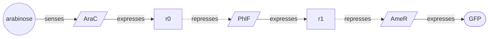

# Quiver 🏹

**Machine learning for the diverse design of gene-regulatory circuits.** Tell Quiver what you want a cell to
do and it returns a _quiver_ of candidate circuits that do it: structurally distinct
[LOICA](https://github.com/RudgeLab/LOICA) designs, built from parts you have characterized.

A simulation is a proxy for behavior in a cell, so Quiver delivers a batch rather than a single prediction.
Candidates that fail for different reasons are likelier to contain one that works, so the batch spans
distinct circuit layouts and distinct parts. (A quiver is also a directed graph, which is what a
gene-regulatory circuit is.)

## A circuit, end to end

```python
import quiver
from quiver import Component, Parts, Strain

inventory = Parts(
    [
        Component.repressor("PhlF", ymax=3.9, ymin=0.01, K=0.03, n=4.0),
        Component.repressor("AmtR", ymax=3.8, ymin=0.06, K=0.07, n=1.6),
        Component.repressor("BetI", ymax=3.8, ymin=0.07, K=0.41, n=2.4),
        Component.repressor("AmeR", ymax=3.8, ymin=0.2, K=0.09, n=1.4),
        Component.repressor("HlyIIR", ymax=2.5, ymin=0.07, K=0.19, n=2.6),
        Component.sensor("AraC", detects="arabinose", ymax=2.5, ymin=0.008),
        Component.reporter("GFP"),
    ],
    strain=Strain("MG1655"),
)

batch = quiver.design(
    senses=inventory.inducer("arabinose"),
    reports=inventory.reporter("GFP"),
)

circuit, report = batch.best
print(circuit.draw())
```



Arabinose drives the `AraC` sensor, whose output represses the `PhlF` stage, whose output represses the
`AmeR` stage, which expresses GFP. Slanted boxes are promoters, labelled by the part filling them, and `r0`
and `r1` are the intermediate transcription factors each stage produces. Two repressions in series invert
twice, so GFP rises with arabinose — a cascade Quiver found and filled from the five repressors on hand.

What it does:

```python
print(report)
```

```
does what you asked:  GFP comes on when the cell sees arabinose

  on vs off brightness       16x
  leakiness                  6% of the on level
  parts                      3
  kinetics from measurement  67% measured, the rest assumed
```

A report carries the quantities the parts support. These parts measure on and off levels, so brightness and
leakiness are reported; they carry no sensor dose-response, so the dose at which the circuit switches is
absent. `kinetics from measurement` is the share of a circuit's kinetic values taken from a measurement
rather than a default.

`batch` holds eight such candidates, each doing what you asked and each assemblable from your inventory: a
design that already fails in simulation, or that leaves a stage with no part to order, is not delivered.
`circuit.to_loica()` hands any of them to LOICA to simulate or export.

## Your parts

A library is your own inventory: the parts you have, and the conditions they were measured in. Declare it in
code, as above, or read it from a CSV:

```python
inventory = quiver.parts("lab_inventory.csv", strain=Strain("MG1655"))
```

One row per part. `name` and `role` are required, levels are given as `ymax`/`ymin` or as `dynamic_range`,
and a column a source did not measure is left empty.

| column | meaning |
| --- | --- |
| `name` | the part name, carried into LOICA and SBOL |
| `role` | `repressor`, `activator`, `sensor`, or `reporter` |
| `regulator` | the transcription factor — the orthogonality key, used at most once per circuit |
| `detects` | for a sensor, the molecule it responds to |
| `ymax`, `ymin` | on and off expression levels |
| `K`, `n` | half-maximal point and Hill coefficient, where measured |
| `quality` | `measured`, `fitted`, or `literature` |

You name a signal by the molecule you add to the flask and a readout by its gene:

```python
inventory.inducer("tetracycline")
```

```
NoSensorFor: nothing in your library responds to tetracycline.
  you can sense: arabinose
```

Expression levels are relative to the host and the measurement setup, so each `Inducer` and `Reporter`
knows the library it came from, keeping one circuit inside one set of conditions.

### What your parts support

A circuit is judged only on quantities its parts were measured for, so a library reports what it can be
asked for, and what each remaining behavior needs:

```python
print(inventory.can_design())
```

```
you can ask for:
  responds UP / DOWN  5 repressors, levels measured
  responds PEAK       5 repressors, levels measured
  memory              Hill n measured for 5 parts (1.4-4.0)

you cannot ask for:
  logic BOTH / EITHER / NEITHER      needs a promoter characterized with two regulator inputs
  timing TRANSIENT                   needs how fast each regulator protein is degraded and diluted
  timing OSCILLATING                 needs how fast each regulator protein is degraded and diluted
  thresholds in concentration units  needs a sensor's response measured against inducer concentration
```

The second half is a worklist: it says which measurement unlocks which design.

## Describing a behavior

Four independent choices, which compose. `memory=True` is a latch that stays on after washout,
`logic=Logic.BOTH` across two signals is an AND gate, `timing=Timing.OSCILLATING` is a free-running
oscillator.

| choice | values | meaning |
| --- | --- | --- |
| `responds` | `UP`, `DOWN`, `PEAK` | the readout rises with the signal, falls with it, or is highest in between |
| `logic` | `PRESENT`, `BOTH`, `EITHER`, `NEITHER`, `ONE_ONLY` | how several signals combine |
| `memory` | `True` / `False` | the circuit latches, holding its state after the signal is washed out |
| `timing` | `SUSTAINED`, `TRANSIENT`, `OSCILLATING` | it holds its new level, spikes and settles back, or cycles on its own |

A request that contradicts itself is rejected — a latch holds one state and an oscillator never settles —
and so is one your parts cannot be judged against:

```python
quiver.design(reports=gfp, timing=Timing.OSCILLATING)
```

```
NotCharacterized: whether a feedback loop oscillates or just settles is set by how fast its proteins
  are degraded and diluted, and none of your 7 parts report it.
  to unlock this: measure protein degradation for at least one regulator you would build with.
```

If nothing in a batch meets the brief, the batch says which requirement fell short:

```
nothing did what you asked. the closest fell short on leakiness 41% of the on level, needed 10% or less
```

```python
quiver.design(senses=ara, reports=gfp, memory=True)
```

```
NotSupportedYet: holding a state needs a feedback loop, and the circuit builder only assembles
  feedforward circuits so far, so it cannot reach a latch.
```

`NotCharacterized` is answered by a measurement, `NotSupportedYet` by work on Quiver.

> **What Quiver can design today:** `responds=UP` or `DOWN` on a single signal, with `Timing.SUSTAINED`.
> `memory`, `logic`, `Timing.TRANSIENT`, `Timing.OSCILLATING` and `Responds.PEAK` raise `NotSupportedYet` —
> the circuit builder assembles feedforward circuits and the simulator varies one signal at a time. Widening
> both is the next body of work.

## Steering the next batch

Candidates that all do the job can still differ in ways you care about, so a preference ranks them:
`CONTRAST` is the largest gap between on and off, `LOW_BACKGROUND` the least expression when off,
`FEW_PARTS` the simplest to assemble, `PREDICTABILITY` the least reliant on assumed values.

```python
quiver.design(senses=ara, reports=gfp, prefer=Prefer.LOW_BACKGROUND)

batch.sorted_by(Prefer.CONTRAST)
batch.best_for(Prefer.FEW_PARTS)
```

## Train once, design many

`quiver.train` learns across every signal a library can sense, and the trained designer answers each
request by sampling:

```python
designer = quiver.train(inventory, reports=gfp)

designer.design(senses=ara, reports=gfp)
designer.design(senses=inventory.inducer("IPTG"), reports=gfp)

designer.save_pretrained("arabinose-designer")
reloaded = quiver.Designer.from_pretrained("arabinose-designer")
```

The policy reads each sensor's measured properties, so a trained designer also handles an inducer it did not
train on: a new sensor with a similar response sits near ones it has seen. The parts are saved with the
weights, since a designer grounds its designs in them. `reads=Reads.GRAPH` swaps the feature-summary policy
for one that reads the circuit as a graph, message passing over each part's measured kinetics and signed
wiring; the two representations suit different regimes.

## What it builds

Every stage is a concrete **SBOL Component**: the input sensor from the molecule you are sensing, each
promoter from a gate, with each transcription factor used at most once.

```python
circuit.parts_list()   # ('AraC', 'AmeR', 'PhlF')
```

A build sheet covers the batch, listing for each candidate the parts on the path to the reporter — the
constructs to order:

```python
print(batch.build_sheet())
```

```
GFP comes on when the cell sees arabinose

1. AraC + AmeR + PhlF
2. AraC + AmtR + HlyIIR
3. AraC + HlyIIR + BetI
4. AraC + PhlF + AmtR
5. AraC + AmtR + BetI
6. AraC + BetI + AmeR
7. AraC + HlyIIR + AmtR + BetI + AmeR
8. AraC + AmtR + PhlF
```

## How it scores and samples

Each requirement of a behavior contributes a satisfaction that reaches `1.0` once it is met, and a
candidate's score is the lowest of them. Candidates that all meet the brief therefore score alike, and the
sampler spreads across them instead of climbing toward one.

The generator is a constructive GFlowNet: it learns to _sample_ circuits in proportion to their score, which
is what produces a batch of distinct designs from one policy. Requirements are dimensionless quantities read
from measured parts; absolute quantities resting on uncalibrated values — a switching dose, an oscillation
period — are reported where the parts support them and are not optimized against.

## Build and test

Every design is a LOICA `GeneticNetwork`: draw it, simulate it (ODE or stochastic), export it to SBOL, and
persist it through the [Flapjack](https://github.com/RudgeLab/LOICA) pipeline that scores a measured build.
Quiver is the _design_ step of the Design-Build-Test-Learn cycle, in the language the rest of it speaks.

## Layout

The shipped toolkit is `quiver.parts` (your library), `quiver.intent` (the request), `quiver.grn` (the design
object), `quiver.objective` (simulation), `quiver.report` (what a candidate does), `quiver.learn` (the
sampler), and `quiver.portfolio` (the design call). Baselines, the evaluation harness, and structural
certificates live under `quiver.research`, which holds experiment code and is excluded from the wheel.

## Install

Quiver is not on PyPI yet, so install it from its Git remote. One install pulls every dependency, including
LOICA, torch, and the learned samplers.

```bash
pip install "quiver @ git+https://github.com/marpaia/quiver.git"
```

For development, clone the repository and install it in editable mode:

```bash
git clone git@github.com:marpaia/quiver.git
cd quiver
pip install -e .
```
